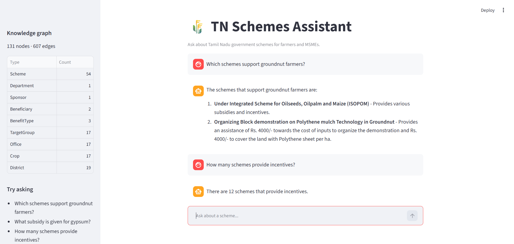

# TN Schemes Assistant

A Knowledge Graph RAG chatbot for Tamil Nadu government schemes from the
[Agriculture - Farmers Welfare Department scheme list](https://www.tn.gov.in/scheme_list.php?dep_id=Mg==).

- **Knowledge graph**: NetworkX, prebuilt offline and saved to `data/graph.json`
- **LLM**: OpenAI `gpt-4o-mini` + `text-embedding-3-small`
- **Guardrails**: NeMo Guardrails (input/output self-check)
- **Evals**: DeepEval (answer relevancy, faithfulness; `gpt-4.1` as judge)
- **UI**: Streamlit

## Demo



https://github.com/user-attachments/assets/f0a3a298-b2bf-43eb-b462-6fab71c3920a

## How it works

1. `build_graph.py` scrapes every scheme page, extracts entities (crops, target groups, districts, offices)
   with the LLM, embeds each scheme and saves the graph.
2. At query time the app loads the graph, finds schemes by vector similarity plus any graph entities
   named in the question, and answers using those schemes and their relations as context.

```
Scheme ──OFFERED_BY──▶ Department     Scheme ──COVERS_CROP──▶ Crop
       ──SPONSORED_BY─▶ Sponsor              ──PRIORITISES──▶ TargetGroup
       ──BENEFITS────▶ Beneficiary           ──AVAILABLE_IN─▶ District
       ──PROVIDES────▶ BenefitType           ──APPLY_AT─────▶ Office
```

## Project structure

```
app.py              Streamlit chat UI
build_graph.py      One-time scrape + graph build
kgrag/
  config.py         Settings from .env
  scraper.py        Scheme list/detail scraping
  graph.py          Entity extraction, graph build/load
  rag.py            Graph retrieval + answer generation
  guard.py          NeMo Guardrails wrapper
guardrails/         NeMo Guardrails config and prompts
evals/test_rag.py   DeepEval tests
data/               schemes.json (scraped) and graph.json (prebuilt graph)
```

## Setup

```bash
python -m venv .venv
.venv\Scripts\activate          # Windows  (source .venv/bin/activate on macOS/Linux)
pip install -r requirements.txt
cp .env.example .env            # add your OPENAI_API_KEY
```

## Run

```bash
python build_graph.py           # only needed if data/graph.json is missing (--refresh to re-scrape)
streamlit run app.py
```

## Evaluate

```bash
deepeval test run evals/test_rag.py
```
